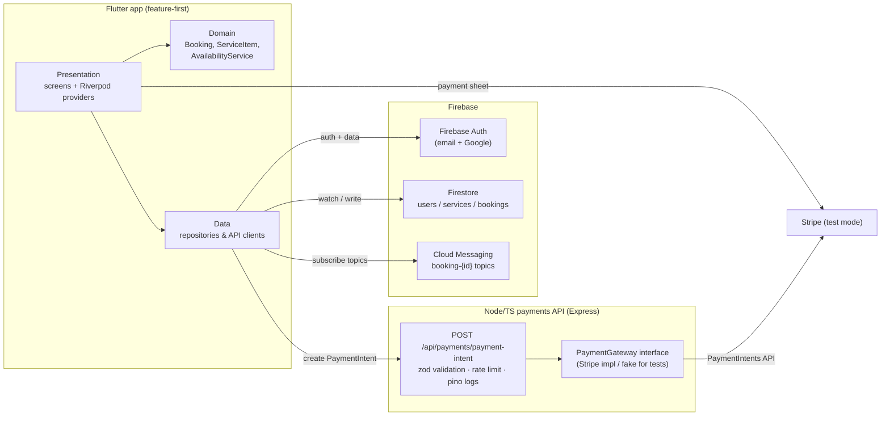
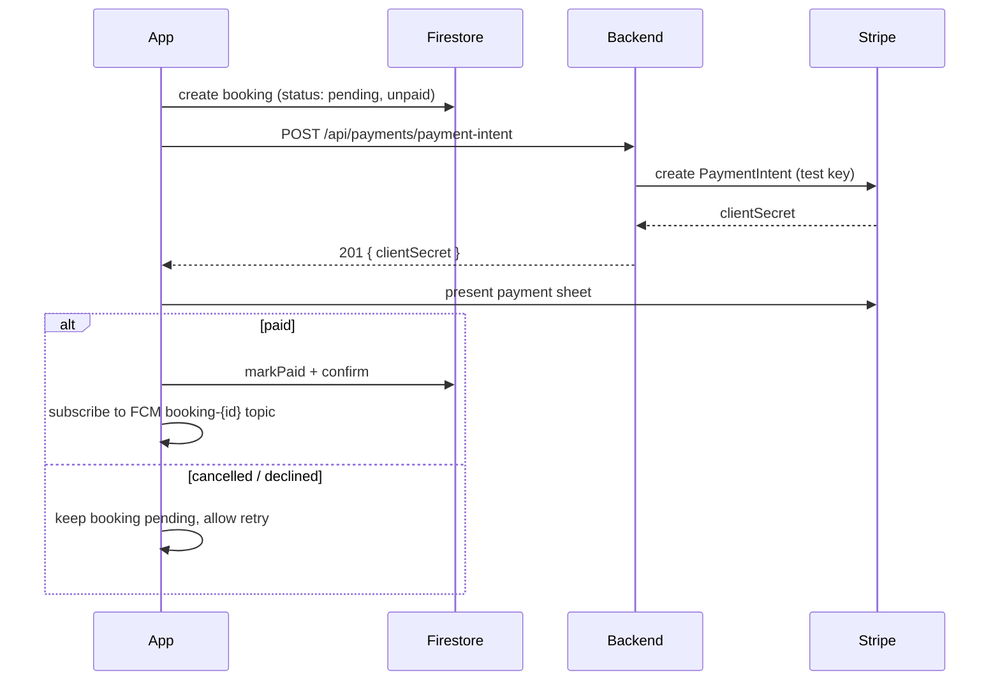

# BookEasy — Flutter Booking & Payments App

A mobile app that lets service businesses (salons, clinics, tutors) take bookings **and payments** from one place — replacing the WhatsApp/phone-tag/Excel workflow most small businesses still rely on.

> Showcase project #1 in the [freelance portfolio](../README.md). All payments run in **Stripe test mode**; no real money moves.

## Problem Solved

Small service businesses lose hours every week to manual scheduling: clients call to ask for availability, double-bookings happen, no-shows go untracked, and taking a deposit means sending a payment link by hand. BookEasy gives the business a self-serve booking calendar with upfront payment, and gives clients a 30-second flow to find a slot, pay, and get a reminder before the appointment.

## Features

| Area | What it does |
|------|--------------|
| **Auth** | Email/password + Google sign-in (Firebase Auth). Roles: `client` and `admin`, stored in a `users` Firestore collection. |
| **Service listing** | Browse active services with category icons, duration and price. Admins also see inactive ones. |
| **Availability & slot booking** | Calendar (table_calendar) + slot grid computed by a pure-Dart engine: Mon–Sat 09:00–17:00, 30-min steps, 1-hour lead time, existing bookings excluded by overlap. |
| **Payments** | Stripe test-mode PaymentIntents created by the companion backend; `flutter_stripe` payment sheet in-app with explicit **success / cancelled / declined** states. Cancelled or declined payments leave a *pending* booking that can be retried. |
| **Booking history** | Upcoming/past bookings with status chips; detail screen with cancel & reschedule (24-hour policy enforced in the domain model). |
| **Reminders** | FCM topic subscription per booking (`booking-{id}`) so reminder pushes can be sent to exactly the right devices. |
| **Profile** | Display name, sign out, theme follows the system (Material 3 light + dark). |
| **Admin** | Manage services (create/edit/activate/deactivate with validation) and view all bookings for any day. |
| **Resilience** | Loading / empty / error / offline states handled uniformly by a shared `AsyncValueView` widget with an offline banner. |

## Architecture



**Checkout flow** (`BookingController.checkout`, fully unit-tested with fakes):



### Folder layout

```
book-easy/
├── backend/                  # Express + TypeScript payments API
│   ├── src/
│   │   ├── config.ts         # zod-validated env (rejects live Stripe keys)
│   │   ├── controllers/      # payment intent controller (amount ceiling)
│   │   ├── middleware/       # validate, error handler
│   │   ├── schemas/          # zod request schemas
│   │   ├── services/         # PaymentGateway interface + Stripe impl
│   │   └── app.ts            # createApp() factory — DI for tests
│   ├── tests/                # vitest + supertest (fake gateway)
│   ├── Dockerfile            # multi-stage, non-root
│   └── docker-compose.yml
└── mobile/                   # Flutter app
    ├── lib/
    │   ├── core/             # theme, router, errors, network, widgets, utils
    │   └── features/
    │       ├── auth/         # domain / data / presentation
    │       ├── services/
    │       ├── bookings/     # incl. AvailabilityService slot engine
    │       ├── payments/     # API client + payment sheet service
    │       ├── profile/
    │       └── admin/
    └── test/                 # unit, provider and widget tests
```

Both sides are built for testability: every external dependency (Stripe gateway, auth, repositories, payment sheet, FCM, HTTP) sits behind an interface and is swapped for a fake in tests.

## Setup

### Prerequisites

- Node.js ≥ 20
- Flutter ≥ 3.44 (Dart ≥ 3.12)
- A Firebase project (Spark plan is enough) with **Auth** (Email/Password + Google), **Firestore** and **Cloud Messaging** enabled
- A Stripe account in **test mode** ([dashboard.stripe.com/test/apikeys](https://dashboard.stripe.com/test/apikeys))
- Docker (optional, for running the backend containerized)

### 1. Backend

```bash
cd backend
cp .env.example .env          # then fill in your sk_test_ key
npm install
npm run dev                   # http://localhost:8080
```

Or with Docker:

```bash
docker compose up --build     # same port, healthcheck included
```

Verify: `curl http://localhost:8080/health` → `{"status":"ok"}`.

#### Backend environment variables

| Variable | Required | Default | Description |
|----------|----------|---------|-------------|
| `PORT` | no | `8080` | HTTP listen port |
| `CORS_ORIGINS` | no | `http://localhost:3000` | Comma-separated allowed origins |
| `STRIPE_SECRET_KEY` | **yes** | — | Stripe **test** key (`sk_test_…`). Startup fails on missing or live keys. |
| `MAX_AMOUNT_CENTS` | no | `100000` | Per-PaymentIntent ceiling in minor units |
| `LOG_LEVEL` | no | `info` | pino level: `fatal`…`trace` |
| `LOG_PRETTY` | no | `false` | Pretty-printed logs for development |

### 2. Firebase config

`mobile/lib/firebase_options.dart` ships as a template. Replace it with your own project's config:

```bash
cd mobile
dart pub global activate flutterfire_cli
flutterfire configure        # overwrites lib/firebase_options.dart
```

Then create the Firestore collections the app expects: `users`, `services`, `bookings`. To make your account an **admin**, sign in once in the app (a user doc is created), then set `role: "admin"` on your document in `users`.

Seed a few services in the `services` collection, e.g.:

```json
{
  "name": "Haircut",
  "description": "Classic cut, wash and style.",
  "category": "Salon",
  "durationMinutes": 30,
  "priceCents": 4500,
  "currency": "usd",
  "isActive": true
}
```

### 3. Mobile app

Configuration is compile-time via `--dart-define` (nothing secret — only the *publishable* key ships in the app):

| Define | Default | Description |
|--------|---------|-------------|
| `PAYMENTS_API_URL` | `http://10.0.2.2:8080` | Backend base URL (`10.0.2.2` = host machine from the Android emulator; use your LAN IP for a physical device) |
| `STRIPE_PUBLISHABLE_KEY` | *(empty)* | Stripe test publishable key (`pk_test_…`) |

```bash
cd mobile
flutter pub get
flutter run \
  --dart-define=PAYMENTS_API_URL=http://10.0.2.2:8080 \
  --dart-define=STRIPE_PUBLISHABLE_KEY=pk_test_YOUR_KEY
```

Test card for the payment sheet: `4242 4242 4242 4242`, any future expiry, any CVC. Use `4000 0000 0000 0002` to see the **declined** state and `pending` booking retry flow.

## Tests

```bash
# backend — 12 tests (vitest + supertest, fake Stripe gateway)
cd backend && npm run lint && npm run typecheck && npm test

# mobile — 54 tests (unit + provider + widget)
cd mobile && flutter analyze --fatal-infos && flutter test
```

What's covered:

- **Backend**: health endpoint, PaymentIntent creation (amount/currency validation, amount ceiling, gateway error mapping, stable 404/500 envelopes), config rejection of live Stripe keys.
- **Mobile unit**: `AvailabilityService` slot engine (opening hours, overlap exclusion, lead time, edge cases), `Booking` domain rules (24h cancel policy, Firestore round-trip), validators & formatters.
- **Mobile providers**: `BookingController.checkout` full matrix (happy path, cancelled sheet, declined card, backend error envelope, create failure short-circuit, markPaid failure), services stream providers with a fake repository.
- **Mobile widget**: `SlotGrid` (render/tap/empty), `ServiceCard`, `AsyncValueView` (loading/data/error+Retry/empty/offline banner with a faked connectivity stream).

CI runs all of the above on every push touching `book-easy/` (see [`.github/workflows/ci.yml`](../.github/workflows/ci.yml)).

## Screenshots / Demo Notes

Screens worth capturing for a client demo (add them to a `docs/screenshots/` folder and link them here):

1. **Services list** (light theme) — category icons, price/duration formatting.
2. **Booking flow** — calendar with available-day markers, slot grid, pay button.
3. **Stripe payment sheet** — native sheet over the app (use the `4242` test card).
4. **Payment success** — confirmed + paid chips on the booking detail screen.
5. **Declined payment** — error snackbar with the pending booking kept for retry.
6. **Booking history** — upcoming vs past, status chips.
7. **Admin screen** — service editor form with validation errors visible.
8. **Offline state** — airplane mode toggled on: banner + cached data still shown.
9. **Dark theme** — any screen with the system theme switched to dark.

Demo script (≈3 min): sign in → browse services → pick a slot → pay with the test card → show success state → open history → cancel a booking (24h policy) → switch to an admin account → edit a service → show the day view of all bookings.

## Release Checklist (Google Play)

### Signing

- [ ] Generate an upload keystore: `keytool -genkey -v -keystore upload-keystore.jks -keyalg RSA -keysize 2048 -validity 10000 -alias upload`
- [ ] Store it **outside** the repo; reference it from `android/key.properties` (git-ignored):
      ```properties
      storePassword=...
      keyPassword=...
      keyAlias=upload
      storeFile=/absolute/path/to/upload-keystore.jks
      ```
- [ ] Confirm `android/app/build.gradle` reads `key.properties` and falls back to debug signing when absent.
- [ ] Enrol in **Play App Signing** when uploading (Google holds the signing key; the upload key can be rotated).

### Pre-build

- [ ] Bump `version` in `pubspec.yaml` (`<version>+<buildNumber>`).
- [ ] Set production values: `flutterfire configure` for the **production** Firebase project; production Firestore security rules deployed.
- [ ] Backend deployed publicly over **HTTPS**; update `PAYMENTS_API_URL` accordingly.
- [ ] Move the backend to Stripe **live** keys only when the business is ready to accept real money (this repo intentionally refuses `sk_live_` keys at startup — remove that guard deliberately, not accidentally).
- [ ] App icons and splash screen replaced (no debug/placeholder assets).
- [ ] `flutter analyze --fatal-infos` and `flutter test` pass; `dart format --output=none --set-exit-if-changed .` clean.

### Build

- [ ] Build the app bundle:
      ```bash
      flutter build appbundle \
        --release \
        --dart-define=PAYMENTS_API_URL=https://api.your-domain.com \
        --dart-define=STRIPE_PUBLISHABLE_KEY=pk_live_OR_test_KEY
      ```
- [ ] Sanity-check the `.aab` locally: `flutter run --release` on a physical device (payment sheet works only on real devices/emulators with Google Play services).

### Play Store listing

- [ ] Create the app in **Play Console** (app name, default language, free/paid).
- [ ] Complete **Store presence**: short + full description, app icon (512×512), feature graphic (1024×500), ≥2 phone screenshots.
- [ ] Complete **Privacy & security**: privacy policy URL, data safety form (declares: auth email/name, booking data, device tokens for push), target audience.
- [ ] Declare permissions rationale if prompted (internet, push notifications).
- [ ] Set **App access** instructions for reviewers (a demo account email/password + how to trigger a test booking) — payments apps are rejected without this.
- [ ] Internal testing track first → verify install, sign-in, booking, payment → production rollout (staged %).
- [ ] Record the released version + build number and tag the commit.

### iOS (if needed later)

- [ ] Apple Developer account, certificates via Fastlane or Xcode.
- [ ] `flutter build ipa`, upload with Transporter.
- [ ] Stripe sheet requires no extra entitlements, but push (FCM) needs an APNs key uploaded to Firebase.

## How this helps a client

- **Fewer no-shows, guaranteed revenue.** Upfront Stripe deposits at booking time mean a client who reserves has paid; cancelled/declined payments leave a clear *pending* booking instead of a lost slot.
- **Reclaims the admin's week.** The phone-tag/WhatsApp/Excel scheduling loop is replaced by a self-serve calendar; the business owner sees every booking for any day from the admin screen instead of managing it by hand.
- **A 30-second client flow.** Find a slot → pay → get a reminder, with no back-and-forth — the friction that most small-business booking tools never actually remove.
- **Ships like real product work.** Material 3 theming, handled offline/error/empty states, Firebase-role-based client/admin separation and a documented Play release checklist make the difference between a demo and something a business can put its name on.

## Possible extensions

- **Staff & resource calendars** — model individual providers/rooms with their own availability, so multi-staff businesses (salons, clinics) can book against real capacity instead of a single global schedule.
- **Deposits, refunds & recurring bookings** — Stripe refunds/partial captures on cancel, and standing appointments (weekly lessons) via scheduled PaymentIntents.
- **SMS/email confirmations** — wire FCM reminders plus a transactional email/SMS provider so confirmations reach clients who don't install the app.
- **Business analytics** — occupancy rate, revenue by service, no-show trends surfaced to the admin dashboard.
- **Coupon & pricing rules** — first-booking discounts, off-peak pricing, and multi-service cart checkout.
- **iOS + web** — the Flutter codebase already targets iOS with minimal changes; an admin web console could share the Firebase backend.
