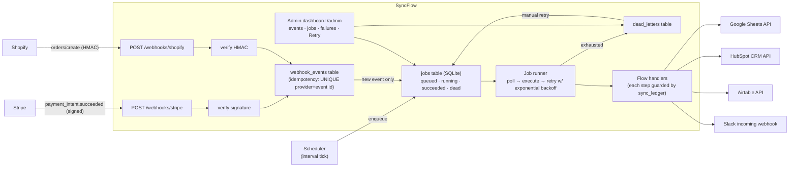
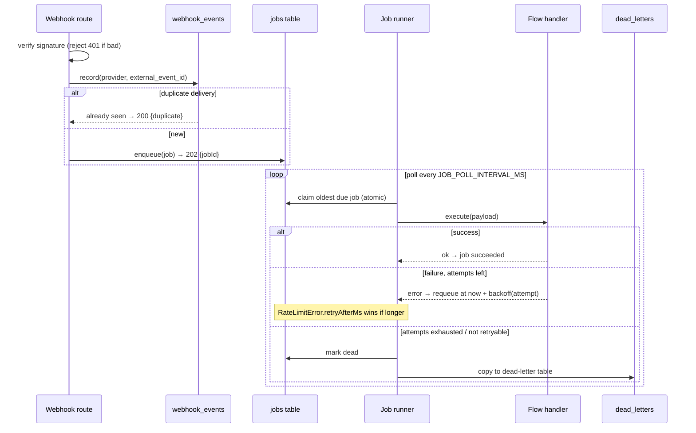

# SyncFlow — Business Integration Hub

A backend service that connects the tools small businesses already use — Stripe, Shopify, Google Sheets, HubSpot, Airtable and Slack — so data moves automatically instead of being re-typed (or lost) between apps.

> Showcase project #2 in the [freelance portfolio](../README.md). Built to the same standard as a paid integration project: signed webhooks, idempotency, retries with backoff, a dead-letter queue, and an admin dashboard with one-click retry.

## Problem Solved

A small business taking payments with Stripe and selling through Shopify typically keeps its books in Google Sheets, its customers in a free CRM, and its team in Slack — and nothing talks to anything else. Someone re-enters every payment into the sheet at the end of the day, deals are created in the CRM "when there's time", and new orders are announced by whoever remembers. Zapier/Make can fix this, but per-task pricing gets expensive fast and multi-step logic (dedupe, partial-failure recovery, audit trail) is exactly where no-code tools fall over. SyncFlow is the custom-code answer: one small service, owned outright, with production-grade reliability patterns.

## The Three Flows

| # | Trigger | Pipeline |
|---|---------|----------|
| 1 | **Stripe** `payment_intent.succeeded` webhook | verify signature → append row to **Google Sheets** → upsert contact + closed-won deal in **HubSpot** |
| 2 | **Shopify** `orders/create` webhook | verify HMAC → normalise order → create record in **Airtable** → notify **Slack** |
| 3 | **Scheduled** (every 15 min, configurable) | pull **Airtable** inbox table → append only *never-seen* records to a mirror **Google Sheet** (duplicate protection via sync ledger) |

## Architecture



**Job lifecycle** (at-least-once execution, exactly-once side effects):



### Production patterns implemented

- **Webhook signature verification** — Stripe via the official SDK (`constructEvent`, includes replay protection); Shopify via HMAC-SHA256 + `timingSafeEqual`. Bodies are consumed **raw**, never parsed before verification.
- **Idempotency at three levels** — `webhook_events UNIQUE(provider, external_event_id)` stops redeliveries; `sync_ledger` makes every *step* of every flow run at most once (claims are rolled back if the step fails, so retries resume instead of skipping); admin retries create fresh, fully-tracked jobs.
- **Retry with exponential backoff + equal jitter** — `base · 2^(attempt-1)` capped at `BACKOFF_MAX_MS`, half-randomised to avoid thundering herds.
- **Rate-limit handling** — clients map HTTP 429 (+`retry-after`) to `RateLimitError`; the runner never retries sooner than the provider asked.
- **Dead-letter table** — exhausted jobs are copied to `dead_letters` with their payload and error, and can be re-run from the dashboard.
- **Structured logging** — pino JSON logs with credential/signature-header redaction; every job transition logged with ids.
- **Input validation** — zod for config and every webhook/job payload; unusable Shopify payloads are rejected with 422 instead of queued.
- **Consistent error envelope** — `{ error: { code, message, details? } }` for every failure, stable codes (`invalid_signature`, `not_configured`, …).
- **Health endpoint** — `GET /health` returns status, uptime and live queue counts (also used as the Docker healthcheck).

## Tech Stack (and why)

- **Node.js 20 + TypeScript + Express** — same stack as the BookEasy backend in this monorepo: shared CI/lint/test patterns, and the official Stripe SDK provides battle-tested webhook verification. Express is deliberately boring: this service is I/O orchestration, not compute.
- **SQLite (better-sqlite3, WAL mode)** — the workload is a single-node job queue + event log. SQLite is zero-ops, transactional, and trivially backed up (it's one file). All access goes through repository classes, so migrating to PostgreSQL is a contained change if SyncFlow ever needs multiple instances.
- **In-process job runner** — polling the `jobs` table keeps the moving parts at exactly one process. For higher throughput the same schema supports multiple workers (claims are atomic conditional updates); for heavier scale you'd swap the table for Redis/BullMQ without touching flow code.

## Setup

### Prerequisites

- Node.js ≥ 20
- (Optional) Docker
- Accounts/keys for whichever integrations you want to exercise — **everything is optional**: unconfigured flows dead-letter with a clear `ConfigError` message instead of crashing, which you can watch in the dashboard.

### Local development

```bash
cp .env.example .env      # fill in what you have
npm install
npm run dev               # http://localhost:8081
```

- Health: `curl http://localhost:8081/health`
- Dashboard: open `http://localhost:8081/admin/`

### With Docker

```bash
cp .env.example .env
docker compose up --build
```

SQLite data persists in the `syncflow-data` volume; the container runs read-only as a non-root user with a `/health` healthcheck.

### Triggering the flows in development

**Stripe (Flow 1)** — forward test events to your local endpoint with the Stripe CLI:

```bash
stripe listen --forward-to localhost:8081/webhooks/stripe
# prints a whsec_... secret → put it in STRIPE_WEBHOOK_SECRET
stripe trigger payment_intent.succeeded
```

**Shopify (Flow 2)** — with a development store, register a webhook for `orders/create` pointing at your public URL (e.g. via `ngrok http 8081`), or use the Shopify CLI:

```bash
shopify webhook trigger --topic=orders/create --address=https://YOUR_NGROK/webhooks/shopify
```

The HMAC secret is the app's client secret (`SHOPIFY_HMAC_SECRET`).

**Scheduled pull (Flow 3)** — set `AIRTABLE_PULL_INTERVAL_MS=30000`, add rows to the Airtable `Inbox` table, and watch them appear once in the mirror sheet.

### Google Sheets access

Create a Google Cloud service account, enable the Sheets API, download the JSON key, and share each target spreadsheet with the service account's `client_email` (Editor). Point `GOOGLE_SERVICE_ACCOUNT_KEY_PATH` at the key file. SyncFlow implements the OAuth2 JWT-bearer flow directly — no googleapis dependency.

### Environment variables

| Variable | Required | Default | Description |
|----------|----------|---------|-------------|
| `PORT` | no | `8081` | HTTP port |
| `DATABASE_PATH` | no | `./data/syncflow.db` | SQLite file (`:memory:` for throwaway) |
| `LOG_LEVEL` / `LOG_PRETTY` | no | `info` / `false` | pino level / pretty dev logs |
| `JOB_POLL_INTERVAL_MS` | no | `1000` | Runner poll interval |
| `JOB_MAX_ATTEMPTS` | no | `5` | Attempts before dead-lettering |
| `BACKOFF_BASE_MS` / `BACKOFF_MAX_MS` | no | `1000` / `300000` | Exponential backoff bounds |
| `STRIPE_WEBHOOK_SECRET` | Flow 1 | — | `whsec_…` signing secret; endpoint returns 503 without it |
| `SHOPIFY_HMAC_SECRET` | Flow 2 | — | App client secret; endpoint returns 503 without it |
| `GOOGLE_SERVICE_ACCOUNT_KEY_PATH` | Flows 1, 3 | — | Service-account JSON key path |
| `PAYMENTS_SHEET_ID` / `PAYMENTS_SHEET_NAME` | Flow 1 | — / `Payments` | Stripe payments target sheet |
| `AIRTABLE_MIRROR_SHEET_ID` / `AIRTABLE_MIRROR_SHEET_NAME` | Flow 3 | — / `Airtable` | Airtable mirror target sheet |
| `HUBSPOT_ACCESS_TOKEN` | Flow 1 | — | Private-app token (free CRM) |
| `AIRTABLE_API_KEY` / `AIRTABLE_BASE_ID` | Flows 2, 3 | — | Airtable credentials |
| `AIRTABLE_ORDERS_TABLE` / `AIRTABLE_PULL_TABLE` | no | `Orders` / `Inbox` | Table names |
| `SLACK_WEBHOOK_URL` | Flow 2 | — | Incoming-webhook URL |
| `AIRTABLE_PULL_INTERVAL_MS` | no | `900000` | Flow 3 schedule |

## Admin Dashboard

Served at `/admin` (static page, no build step) on top of the JSON API under `/admin/api`:

- **Queue summary cards** — queued / running / succeeded / dead counts
- **Failures (dead letters)** — error, attempts, payload age, and a **Retry** button that re-enqueues a fresh copy of the job
- **Recent jobs** — per-job status, attempt counter, last error, manual **Re-run**
- **Recent webhook events** — provider, external id, accepted vs duplicate

Demo notes / screenshots to capture: (1) dashboard after a successful Stripe payment, (2) a dead-lettered job with the `ConfigError` message after unsetting `HUBSPOT_ACCESS_TOKEN`, (3) clicking Retry after fixing the config and the job going green, (4) the duplicate badge after replaying a webhook with `stripe events resend`.

## Tests

```bash
npm run lint && npm run typecheck && npm test    # 44 tests
```

- **Webhook verification** (`tests/webhooks.test.ts`) — real Stripe SDK-signed payloads (accepted, tampered → 401, missing header → 401, wrong event type ignored) and real HMAC-signed Shopify requests (accepted, wrong secret → 401, modified body → 401, unnormalisable → 422).
- **Idempotency** — redelivered webhooks are answered `duplicate` and never re-queued; flow handlers re-run after partial failure execute only the missing step (sheets row appended exactly once).
- **Retry logic** (`tests/retry.test.ts`) — backoff math (growth, jitter bounds, cap), requeue-not-immediate, dead-lettering at max attempts, non-retryable unknown job types, `RateLimitError.retryAfterMs` override, drain semantics.
- **Flows** (`tests/flows.test.ts`) — event parsing/normalisation, all three flows end-to-end against in-memory fakes, duplicate protection of the scheduled pull, scheduler→queue→runner wiring.
- **Admin API** (`tests/admin.test.ts`) — health, listings, job retry, dead-letter retry, 404/400 envelopes, dashboard serving.

CI runs lint + typecheck + tests on every push touching `syncflow/` ([workflow](../.github/workflows/ci.yml)).

## No-Code vs Custom Code

### The Zapier/Make equivalent of Flow 1

Flow 1 maps 1:1 onto a standard no-code scenario. In **Zapier**:

1. **Trigger:** Stripe → *New Payment Intent Succeeded* (or "Successful Charge").
2. **Action:** Google Sheets → *Create Spreadsheet Row*: map `Amount`, `Currency`, `Customer Email`, `Payment Intent ID`, `Created` onto columns.
3. **Action:** HubSpot → *Create/Update Contact* (match on email), then a second step *Create Deal* with `Amount`, stage `Closed Won`, associated with the contact.
4. **Settings:** turn on *Auto-replay* (Zapier's redelivery protection) and *error notification*.

In **Make** the same scenario is: `Stripe → Watch Payment Intents` ▸ `Google Sheets → Add a Row` ▸ `HubSpot → Create/Update a Contact` ▸ `HubSpot → Create a Deal`, with an attached **error handler** route (Make's equivalent of the dead-letter table) and the built-in *Ignore duplicate messages* option on the Stripe module.

### When to use which

| Use **no-code** (Zapier/Make) when… | Use **custom code** (SyncFlow-style) when… |
|---|---|
| 1–3 simple triggers, linear app→app copies | Flows need branching, per-step dedupe, or partial-failure recovery |
| The business owns and edits it themselves | You need an **audit trail**: every event, every attempt, every error, queryable |
| Volume is low — per-task pricing stays trivial | Volume is high — Zapier bills per task; a $50/mo plan dies at ~2k tasks, this service costs one $5 VPS |
| Speed to first version matters more than control | You must handle **rate limits and retries** with real backoff, not "re-run whole Zap" |
| Apps have polished, officially supported connectors | The integration is awkward: custom normalisation, webhooks no connector supports, on-prem/system-level sources |
| One person, low blast radius | Multiple flows share state (SyncFlow's ledger protects *across* flows and restarts) |

Rule of thumb I give clients: **prototype in Zapier, migrate to code when the flow starts making money decisions** (payments, inventory, CRM pipeline) or when the monthly task bill approaches the cost of hosting a small service. The migration is cheap because the no-code prototype already documented the exact field mappings.

## Folder Structure

```
syncflow/
├── src/
│   ├── config.ts               # zod-validated env with safe defaults
│   ├── logger.ts               # pino with credential redaction
│   ├── app.ts                  # composition root (buildServices)
│   ├── index.ts                # bootstrap + graceful shutdown
│   ├── utils/api-error.ts      # error envelope, RateLimitError, ConfigError
│   ├── db/                     # SQLite schema + repositories
│   ├── queue/                  # job runner, backoff, scheduler
│   ├── integrations/           # verifiers + HTTP clients (interfaces in types.ts)
│   ├── flows/                  # the 3 flows + idempotent-step helper + registry
│   ├── middleware/             # central error handler, 404
│   └── routes/                 # /webhooks, /health, /admin/api
├── public/                     # admin dashboard (plain HTML/CSS/JS)
├── tests/                      # vitest + supertest, in-memory db, fakes
├── Dockerfile / docker-compose.yml / .env.example
```

## How this helps a client

- **Reclaims the hours lost to re-typing.** Every payment, order and CRM update that currently gets copied by hand between Stripe, Shopify, Sheets, HubSpot and Airtable happens automatically, with the audit trail to prove it happened.
- **Reliable where no-code quietly isn't.** Signed webhooks, idempotency, retries with real backoff and a dead-letter queue mean a temporary API outage or a redelivered event doesn't turn into duplicate rows or silently-dropped orders — the exact failure mode that makes Zapier bills and support tickets spike.
- **Costs a hosting fee, not per-task pricing.** At a few thousand events a month the SaaS automation bill approaches (then exceeds) the cost of running this on one small VPS; the client owns the service outright.
- **Operators can self-serve.** The dashboard shows queued/running/dead counts and a one-click Retry, so fixing a failure after correcting a credential doesn't require a developer on call.

## Possible extensions

- **Horizontal scale** — move the `jobs` table to Postgres (multiple workers already safe via atomic claims) or Redis/BullMQ for throughput; the repository layer keeps that swap contained.
- **More providers & flows** — the registry + `sync_ledger` pattern makes adding a new integration (Xero, QuickBooks, Gmail) mostly a matter of one client + one flow handler.
- **Declarative flows** — let clients compose steps from a UI (stored as data, executed by the same engine) to bridge the gap between hard-coded flows and full no-code.
- **Delivery guarantees** — outbound webhooks/retries back to external systems, plus per-event replay from the dashboard for recovery drills.
- **Auth & multi-tenancy** — the admin API is intentionally unauthenticated for the demo; production needs an operator auth layer and per-tenant credential vaults (see BookEasy/Firebase).
